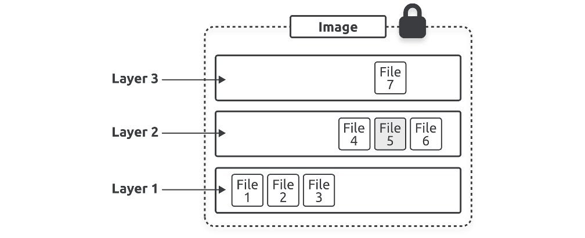
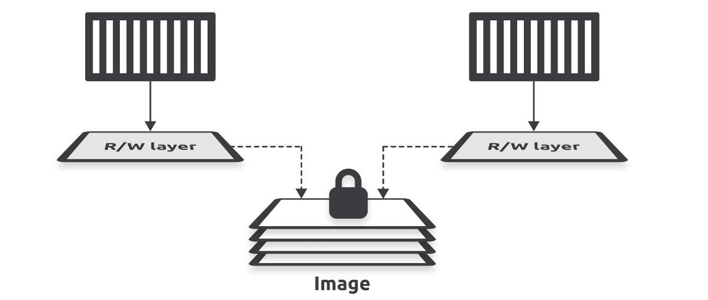

# Docker


- [Docker Command Cheatsheet](#docker-command-cheatsheet)

## What is Docker?

- In the container ecosystem, **Docker** refers to two distinct things:

- **Docker, Inc.**: The technology company that created the platform (originally founded as dotCloud).
- **The Docker Platform**: A neatly packaged collection of technologies that makes it easy to **build**, **share**, and **run** containerized applications.

At a high level, Docker operates on a **client-server architecture**

- **The CLI (Client)**: The `docker` command-line tool you interact with in your terminal. It takes user commands and translates them into REST API calls.
- **The Docker Engine (Server)**: The background service (daemon) and modular runtimes (`containerd`, `runc`) that receive those API calls and do the heavy lifting of building, managing, and running containers.

### Why Was Docker Needed? (The Evolution)

To understand why Docker became essential, it helps to look at how software deployment evolved through three eras

#### 1\. The Physical Server Era ("The Bad Old Days")

- Originally, organizations ran one application per physical server to prevent conflicts. Because modeling application demand was difficult, companies bought large, overpowered servers to avoid downtime. As a result, servers frequently ran at only **5–10% of their actual capacity**, wasting massive amounts of capital and power

#### 2\. The Virtual Machine (VM) Era

- Hypervisor technology (such as VMware) introduced **hardware virtualization**. A hypervisor carves physical hardware into virtual CPUs, virtual memory, and virtual disks, creating Virtual Machines that behave like separate physical computers.

- While VMs allowed multiple applications to share one server, they introduced what is known as the **"VM tax"**
  - **Heavy resource overhead**: Every VM must run its own full guest operating system (OS), consuming substantial CPU, RAM, and disk storage that could otherwise go to applications.
  - **Maintenance bloat**: Every guest OS requires its own licensing, OS patching, and system monitoring.
  - **Slow startup times**: VMs must execute a full OS boot process before the application can start.

#### 3\. The Container Era &amp; Docker

Unlike VMs, which virtualize hardware, containers perform **operating system virtualization**.

Instead of bundling an entire guest operating system, containers **share the host system's kernel**. Linux had long included underlying technologies to isolate processes—most notably **kernel namespaces** (which partition resources like process trees, network stacks, and mount points) and **control groups (cgroups)** (which enforce limits on CPU, memory, and I/O). However, these native kernel tools were notoriously complex and difficult to use.

**Docker was the breakthrough that made Linux containers simple and accessible to the world**. It encapsulated complex kernel constructs behind an intuitive CLI and standardized workflows.

### Key Advantages of Docker Containers

- **High Density and Efficiency**: Because containers do not carry guest operating systems, a host that might only support 10 VMs can easily run 50 or more containers.
- **Lightweight Size**: Traditional container images only contain application code, dependencies, and minimal filesystem files—often measuring just tens of megabytes (e.g., an Alpine Linux base image is around 3–5 MB) compared to multiple gigabytes for a full OS.
- **Instant Startup**: Containers start in seconds or fractions of a second because the host OS kernel is already booted and running.
- **Portability and Consistency**: A containerized application packages all required dependencies together, guaranteeing that if it runs on a developer's machine, it will run identically on test servers or production environments.

### Images vs. Containers: The High-Level Picture

To grasp the difference between images and containers, it helps to view them through two lenses:

| Aspect           | Image (Build-time)                                                                                               | Container (Run-time)                                                                             |
| ---------------- | ---------------------------------------------------------------------------------------------------------------- | ------------------------------------------------------------------------------------------------ |
| **Concept**      | A stopped, read-only blueprint containing the application, dependencies, filesystem, and configuration metadata. | A living, running instance executing the application process isolated on top of the host kernel. |
| **Analogy**      | Like a **Class** in programming or a **VM template**.                                                            | Like an **Object/Instance** of a class or a running VM.                                          |
| **State**        | **Immutable and read-only**; cannot be modified once built.                                                      | **Read-write and ephemeral**; has its own writable state.                                        |
| **Relationship** | One image can act as the source for **multiple independent containers**.                                         | Every container is instantiated from **exactly one base image**.                                 |

---

### How They Work Under the Hood

- Under the hood, Docker accomplishes this separation using three core layers:

1. The Storage/Filesystem Layer (Layers, Union Filesystems, and Copy-on-Write)
2. The Execution Architecture (Docker Daemon $\rightarrow$ containerd $\rightarrow$ shim $\rightarrow$ runc)
3. The Kernel Isolation Layer (Namespaces, cgroups, Capabilities, and Seccomp)

#### 1\. The Filesystem Layer: Layers &amp; Copy-on-Write (CoW)

##### What an Image Actually Is

An image is not a single giant binary blob. It is a **collection of independent, stacked read-only layers** defined by an image manifest.

- Each instruction in a Dockerfile that adds content (such as `FROM`, `RUN`, or `COPY`) generates a separate read-only layer identified by a cryptographic content hash (SHA256 digest).
- If two different images share identical layers (for instance, both use the exact same Ubuntu base layer), Docker stores that layer **only once** on the host, saving disk space and network bandwidth.

##### The Union Mount (`overlay2`)

Under the hood, Docker uses a **storage driver** (predominantly `overlay2` on modern Linux) to perform a **union mount**. The driver stacks all the independent read-only image layers on top of each other and projects them to the container as a single, coherent filesystem view. If a file in a higher layer has the same name or path as a file below it, the higher file obscures the lower file.



##### The Container's Thin Read-Write Layer

When you run `docker run`, Docker does not duplicate the image. Instead, it places a **thin, writable layer (the container layer)** directly on top of the stacked read-only image layers:

- **Reading data**: The container reads directly down through the stack from the immutable image layers.

- **Writing/Modifying data (Copy-on-Write)**: If a process inside the container modifies an existing file from the image, the storage driver copies the file up into the container's thin writable layer and applies the changes there. The original file in the underlying image remains unchanged.
- **Lifecycle**: If the container stops and restarts, this writable layer remains intact. However, as soon as the container is deleted (`docker rm`), this thin writable layer is deleted along with it.

- `Note`: this is the example when we edit the code on our filesystem it directly updates inside the container.



#### 2\. The Engine Architecture: What Happens During `docker run`?

The modern Docker Engine is completely `decoupled` into modular components

```text
[ Docker CLI ]
      │ (REST API via /var/run/docker.sock)
      ▼
[ dockerd (Daemon) ]
      │ (gRPC)
      ▼
[ containerd ]  ── (High-level runtime: manages images, lifecycles)
      │
      ▼
   [ shim ]     ── (Maintains I/O streams, enables daemonless restarts)
      │
      ▼
   [ runc ]     ── (Low-level OCI runtime: interfaces with Linux kernel)
      │
      ▼
[ Container Process (PID 1) ]
```

When you enter `docker run `:

1. **Docker CLI** $\rightarrow$ Daemon (`dockerd`): The CLI converts your command into a REST API call and sends it to the Docker daemon via the local Unix socket (`/var/run/docker.sock`).
2. **Daemon** $\rightarrow$ containerd: The daemon receives the call and forwards the request over gRPC to containerd32. The daemon no longer contains the code that executes containers.
3. **containerd** $\rightarrow$ OCI Bundle: `containerd` unpacks the image layers, sets up the configuration, and turns the image into an Open Container Initiative (OCI) bundle.
4. **containerd** $\rightarrow$ runc: `containerd` calls runc (the OCI reference low-level runtime).
5. **runc** $\rightarrow$ **Kernel Setu**p: runc communicates with the Linux kernel (via libcontainer), constructs the required namespaces and cgroups, starts the container's primary process (PID 1), and then exits immediately.
6. **The Shim**: Before `runc` exits, `containerd` forks a lightweight process called the **shim**, which becomes the container’s parent process. The shim keeps the container's `STDIN` and `STDOUT` streams open and reports exit codes. Because the shim sits between `containerd` and the running container, the Docker daemon can be stopped, restarted, or upgraded without terminating running containers (**daemonless containers**).

### 3\. Kernel Isolation: How a Container Actually Runs

A container is not a virtual machine—**there is no hypervisor and no guest operating system kernel**. A container is simply a **regular Linux process** running directly on the host's kernel, constrained by native kernel features:

#### A. Kernel Namespaces (Isolation)

Namespaces give the process the illusion that it is running on its own dedicated operating system:

- **PID namespace**: Gives the container its own isolated process tree where its primary process is seen as **PID 1**.
- **NET namespace**: Provides an isolated network stack with its own loopback device, virtual Ethernet interface (`veth`), IP address, routing table, and port range.
- **MNT (Mount) namespace**: Isolates the filesystem mount points so the container can only see its unified union-mounted root filesystem.
- **IPC namespace**: Isolates inter-process communication and shared memory.
- **UTS namespace**: Allows the container to have its own independent hostname.
- **USER namespace**: Allows mapping user IDs (for example, running as `root` inside the container while mapping to an unprivileged standard user on the host).

#### B. Control Groups / cgroups (Resource Metering &amp; Limits)

While namespaces handle _isolation_, cgroups handle _resource governance_. They prevent a single container from exhausting host resources by setting hard caps and shares on:

- CPU usage
- RAM memory limits
- Disk and network I/O throughput

#### C. Security Hardening (Capabilities &amp; Seccomp)

- **Capabilities**: Linux breaks superuser privileges down into granular units (e.g., `CAP_NET_BIND_SERVICE`, `CAP_CHOWN`). Docker starts containers by dropping dangerous root capabilities by default to follow the principle of least privilege.
- **Seccomp (Secure Computing)**: Restricts which system calls (syscalls) the container process can make to the host kernel, preventing malicious or compromised processes from attacking the host.

---

### 1\. What is a Dockerfile?

A **Dockerfile** is a plain-text configuration file containing an ordered sequence of instructions that tell the Docker builder how to package an application, its dependencies, runtime, and configuration into an immutable container image[1].

Just as source code compiles into an executable, a Dockerfile acts as the source code from which Docker builds an OCI-compliant container image.

---

### 2\. What is the Main Use of a Dockerfile?

The primary purpose of a Dockerfile is **containerization**—automating the build, sharing, and running of applications:

- **Reproducibility**: It eliminates the classic _"it works on my machine"_ problem by defining the exact operating system filesystem, dependencies, and startup commands.
- **Infrastructure as Code (IaC)**: Dockerfiles live in version control alongside your application code, allowing you to track changes to runtime environments and libraries over time.
- **Automated CI/CD Pipelines**: Build servers read the Dockerfile to produce standardized images that can be tested, scanned for vulnerabilities, and pushed to registries.

---

### 3\. Anatomical Structure &amp; Core Instructions

Docker parses the Dockerfile line by line from top to bottom. Each non-comment line follows the syntax:

```
INSTRUCTION arguments
```

Lines starting with `#` are treated as comments[2].

It helps to know that Dockerfile instructions fall into two categories[2][12]:

1. **Content instructions (create filesystem layers)**: Instructions that add files or install programs (e.g., `FROM`, `RUN`, `COPY`, `WORKDIR`) create physical read-only layers on disk.
2. **Metadata instructions (do not create layers)**: Instructions that set configuration or defaults (e.g., `ENV`, `EXPOSE`, `CMD`, `ENTRYPOINT`) only add configuration metadata to the image manifest and have zero layer size.

#### The Core Instructions

| Instruction                  | What It Does                                                                                                                                                                        | Example                   |
| ---------------------------- | ----------------------------------------------------------------------------------------------------------------------------------------------------------------------------------- | ------------------------- |
| **FROM**                     | Specifies the **base image** on which everything else is stacked. It is typically the first instruction and should leverage trusted _Docker Official Images_.                       | `FROM node:20-alpine`     |
| **WORKDIR**                  | Sets the active working directory inside the image for any subsequent `RUN`, `COPY`, `CMD`, or `ENTRYPOINT` instructions. If the folder doesn't exist, Docker creates it.           | `WORKDIR /usr/src/app`    |
| **COPY**                     | Copies files and folders from your machine's **build context** (the directory containing your application) into the image filesystem.                                               | `COPY package.json .`     |
| **RUN**                      | Executes commands during the image build process (e.g., updating packages, compiling code, installing dependencies). Each `RUN` produces a new layer.                               | `RUN npm install`         |
| **ENV**                      | Sets key-value environment variables that persist both during the build process and when the container runs.                                                                        | `ENV NODE_ENV=production` |
| **EXPOSE**                   | Documents which network port the application inside the container intends to listen on. _(Note: It does not publish the port to the host; it acts as architectural documentation_). | `EXPOSE 8080`             |
| **USER**                     | Specifies a non-root user account to run the application, adhering to the security principle of least privilege.                                                                    | `USER node`               |
| **CMD** &amp; **ENTRYPOINT** | Defines the default executable and arguments that Docker runs when instantiating a container.                                                                                       | `CMD ["node", "app.js"]`  |

---

### 4\. `CMD` vs. `ENTRYPOINT`: A Crucial Difference

Both instructions tell Docker what to run when the container starts, but they behave differently when arguments are passed via the CLI:

- **CMD**: Sets a default command or default parameters that can be **easily overridden** by passing arguments at runtime.
  - If a Dockerfile specifies `CMD ["python", "app.py"]`, running `docker run my-image bash` completely ignores `python app.py` and runs `bash` instead.
- **ENTRYPOINT**: Sets a fixed executable that **cannot be overridden** by standard CLI arguments.
  - If a Dockerfile specifies `ENTRYPOINT ["python", "app.py"]`, running `docker run my-image --debug` appends `--debug` as an argument to `python app.py` (executing `python app.py --debug`).
- **Best practice**: Pair them together—use `ENTRYPOINT` for the fixed application binary and `CMD` for default, overridable flags. Always use the **exec form** (`["executable", "param1"]`) rather than shell form to ensure the process runs as **PID 1** and properly receives termination signals.

---

### 5\. Writing a Production-Ready Dockerfile (Step-by-Step Example)

Here is a practical Dockerfile for a Node.js web application implementing best practices:

```DOCKERFILE
# 1. Base image (minimal Alpine Linux variant)
FROM node:20-alpine

# 2. Set environment variables
ENV NODE_ENV=production

# 3. Create and set the working directory
WORKDIR /usr/src/app

# 4. Copy dependency manifests FIRST to leverage caching
COPY package.json package-lock.json ./

# 5. Install production dependencies
RUN npm ci --omit=dev

# 6. Copy remaining application source code
COPY . .

# 7. Switch to an unprivileged user for security
USER node

# 8. Document listening port
EXPOSE 8080

# 9. Specify start command
CMD ["node", "app.js"]

```

#### How to Build and Run It:

From the directory where your Dockerfile and source files reside:

```
# 1. Build the image ('.' specifies the local build context)
docker build -t myapp:1.0 .
# 2. Run the container detached (-d) with port mapping (-p host:container)
docker run -d --name myapp-container -p 8080:8080 myapp:1.0
```

_(The trailing period_ _._ _in_ _docker build_ _indicates the_ **build context** _, which is the directory Docker packages and sends to the builder_).

---

### 1\. What is Docker Compose &amp; Why Do We Need It?

Modern cloud-native applications are rarely built as a single, giant container; instead, they are designed as **microservices**—collections of smaller, specialized services (such as a web front-end, a database, a cache, and an authentication service) that work together.

Without Compose, launching an entire multi-container stack requires running multiple long, manual `docker run` commands with dozens of CLI flags to configure ports, networks, and volumes individually:

```
# The painful, manual way:
docker network create my-net
docker volume create db-data
docker run -d --name redis --net my-net -v db-data:/data redis:alpine
docker run -d --name web --net my-net -p 8080:8080 -e DB_HOST=redis my-web-app

```

- Managing this across multiple developers and environments is tedious, error-prone, and fragile.

- **Docker Compose** solves this by providing a declarative way to define an entire multi-container application in a single plain-text YAML file (called a **Compose file**). With one command (`docker compose up`), Docker reads the configuration and creates all required containers, networks, and volumes automatically.

#### 2\. The Core Building Blocks of a Compose File

Compose looks for a file named `compose.yaml` (or `compose.yml`) in your working directory. A Compose file is organized under three primary top-level keys:

1. **services** _(Mandatory)_: Defines each containerized microservice that makes up the application.
2. **networks**: Defines the virtual networks used for inter-service communication and automatic DNS service discovery.
3. **volumes**: Declares persistent storage volumes whose lifecycles remain decoupled from individual containers.

#### 3\. A Practical Example: Web + Database Stack

Here is an annotated `compose.yaml` file defining a web application connected to a Redis backend:

```yaml
services:
  # 1. The Web Application Service
  web-fe:
    build: . # Build the image from the local Dockerfile
    command: python app.py # Startup command for the container
    ports:
      - target: 8080 # Port inside the container
        published: 5001 # Port exposed on the host machine
    networks:
      - counter-net # Connect container to custom network
    environment:
      - REDIS_HOST=redis # Environment variable passed to container
    depends_on:
      - redis # Start redis before starting web-fe

  # 2. The Database / Cache Service
  redis:
    image: "redis:alpine" # Pull a pre-built image from Docker Hub
    networks:
      - counter-net # Share the network for communication
    volumes:
      - type: volume
        source: counter-vol # Mount the named volume
        target: /data # Path inside the container

# Define the network shared by services
networks:
  counter-net:

# Define persistent storage
volumes:
  counter-vol:
```

#### 4\. How Docker Compose Works Under the Hood

When you deploy an application using Compose, several automated behaviors occur:

- **Automatic Project Naming &amp; Resource Prefixing**: Compose groups resources by assigning a **project name**, which defaults to the name of the folder containing the `compose.yaml` file. All created resources are prefixed with this project name (e.g., in a directory called `myapp`, the network becomes `myapp_counter-net`, the volume becomes `myapp_counter-vol`, and containers are named `myapp-web-fe-1` and `myapp-redis-1`).
- **Automatic Service Discovery (DNS)**: Because both services join `counter-net`, Docker’s embedded DNS server automatically maps each **service name** to its container's internal IP address. The `web-fe` application code connects to Redis simply by addressing `redis:6379`, with no need for hardcoded IP addresses.
- **Decoupled Data Persistence**: When you shut down a Compose stack, Docker removes the containers and networks by default, but **leaves the volumes intact**. When you start the application again, the database mounts the existing volume and retains all data.

#### 5\. Essential Docker Compose CLI Commands

In modern Docker installations, Compose is integrated directly into the `docker` CLI plugin via the `docker compose` command:

| Command                    | What It Does                                                                                                                       |
| -------------------------- | ---------------------------------------------------------------------------------------------------------------------------------- |
| **docker compose up -d**   | Reads the Compose file, builds/pulls images, sets up networks and volumes, and starts all containers in the background (detached). |
| **docker compose ps**      | Lists all running containers within the current Compose project and their mapped ports.                                            |
| **docker compose logs -f** | Streams aggregated, color-coded logs from all services in the stack simultaneously.                                                |
| **docker compose top**     | Displays the processes running inside each container of the application.                                                           |
| **docker compose stop**    | Pauses/stops all containers in the stack without removing them.                                                                    |
| **docker compose restart** | Restarts all stopped containers in the stack.                                                                                      |
| **docker compose down**    | Gracefully stops and **deletes the containers and networks**.                                                                      |
| **docker compose down -v** | Stops and deletes containers, networks, **and associated named volumes**.                                                          |

---

### Docker Ports &amp; Networking

In Docker, networking is what allows microservices to communicate with one another and enables users or external systems to access containerized services.

#### 1\. The Core Architecture: CNM &amp; Libnetwork

Docker’s networking model is governed by the **Container Network Model (CNM)** specification, which defines three fundamental building blocks.

```
┌──────────────────────────────────────────────┐
│                  Container                   │
│  ┌────────────────────────────────────────┐  │
│  │               Sandbox                  │  │
│  │   (Routing table, DNS, IP config)      │  │
│  │                  │                     │  │
│  │            [ Endpoint ]                │  │
│  └──────────────────┬─────────────────────┘  │
└─────────────────────┼────────────────────────┘
                      │ (veth pair)
                      ▼
            ┌──────────────────┐
            │     Network      │
            │ (Virtual Switch) │
            └──────────────────┘

```

1. **Sandbox**: An isolated network stack inside the container created using a Linux **network (** **net** **) namespace**. It contains the container's own virtual interfaces, IP address, routing table, and DNS settings.
2. **Endpoint**: A virtual network interface that connects the sandbox to a network. An endpoint behaves like a physical network card and can only belong to one network at a time.
3. **Network**: A software implementation of an **802.1d bridge (virtual switch)** that groups and isolates connected endpoints.

Under the hood, **`libnetwork`** is the open-source reference implementation of CNM. It manages the **control plane** (management APIs, IP address management/IPAM, and service discovery), while pluggable **network drivers** implement the actual **data plane** (creating the networks and handling packet forwarding).

#### 2\. Single-Host Bridge Networks

The most common network type for standalone containers and local development is the **single-host bridge network**

##### Default `bridge` vs. User-Defined Bridge Networks

When you run `docker network ls`, Docker lists pre-existing default networks

```
$ docker network ls
NETWORK ID     NAME      DRIVER    SCOPE
c7464dce29ce   bridge    bridge    local
c65ab18d0580   host      host      local
42a783df0fbe   none      null      local

```

There is a vital distinction between the **default bridge** and **user-defined bridges**:

| Feature                      | Default `bridge` Network                                                                    | User-Defined Bridge Network (`docker network create`)                                                        |
| :--------------------------- | :------------------------------------------------------------------------------------------ | :----------------------------------------------------------------------------------------------------------- |
| **Kernel Bridge**            | Maps to `docker0` in the Linux kernel.                                                      | Maps to a dedicated kernel bridge named `br-<network-id>`.                                                   |
| **Automatic DNS Resolution** | **No**. Containers cannot find each other by name; you must connect using IP addresses.     | **Yes**. Docker's embedded DNS allows containers to ping and connect to each other simply by container name. |
| **Isolation**                | All containers attach here by default unless specified, creating a shared collision domain. | Isolated from all other networks; only containers explicitly joined can communicate.                         |

#### 3\. How a Bridge Network Works Under the Hood

When you attach a container to a bridge network:

1. Docker creates a **veth** **(virtual Ethernet) pair**.
2. Think of a `veth` pair like a virtual Ethernet cable:

- One end is placed inside the container's network namespace as its `eth0` interface.
- The other end is plugged into the host kernel's bridge switch (e.g., `docker0` or `br-f918f1bb0602`).

3. Docker assigns the container an internal private IP from the network subnet (e.g., `172.17.0.2` or `172.21.0.2`).

#### Automatic DNS Service Discovery

On user-defined networks, each container's DNS queries are routed to Docker’s embedded DNS server at `127.0.0.11`. When container `web` attempts to connect to `redis`, the internal DNS server resolves `redis` directly to its internal container IP address.

#### 4\. Ports: The Truth Behind Port Mapping (`-p`)

Because containers run on an isolated private subnet (e.g., `172.21.0.0/16`), their IP addresses **are not directly routable** from your host's physical network or the public internet.

To expose an application to the outside world, you must use **port mapping**.

```
docker run -d -p 8080:5000 --name webapp my-image
```

#### Syntax:

```
-p <HOST_PORT>:<CONTAINER_PORT>
```

- **Host Port (** **8080** **)**: The port opened on your physical machine or VM.
- **Container Port (** **5000** **)**: The port the application process inside the container is actually listening on.

#### What Happens Under the Hood? (NAT &amp; `iptables`)

When you pass `-p 8080:5000`, Docker does **not** reconfigure the application inside the container. Instead, the Docker daemon creates **iptables** **Network Address Translation (NAT) rules** in the Linux host's kernel:

1. Outside traffic arrives at the host's IP on port `8080`.
2. The host's kernel intercepts this traffic and translates the destination address (**DNAT**) to the container’s private IP and port `5000`.
3. The packet traverses the kernel bridge and the `veth` pair, arriving at the container.

#### `EXPOSE` vs. `-p` / `--publish`:

- **EXPOSE 5000** **(in a Dockerfile)**: This is strictly **documentation/metadata**. It tells developers and tools which port the image is designed to listen on, but it does **not** open or publish any ports on the host.
- **\-p** **/** **\--publish** **(CLI or Compose)**: This actually configures the host firewall and binds the port to enable real external traffic flow.

#### 5\. Other Native Network Drivers

Beyond the default bridge driver, Docker includes several built-in drivers for different architectural needs:

- **host**: Completely removes network isolation. The container shares the host’s network namespace directly. There is no NAT or port mapping—if an app in the container binds to port `80`, it directly occupies port `80` on the host machine.
- **none**: Disables all networking. The container gets a loopback interface (`127.0.0.1`), but no external virtual interfaces.
- **macvlan**: Assigns a real MAC and IP address from your physical LAN to the container, making it appear as a physical server directly on your corporate switch or VLAN. _(Requires the host NIC to support promiscuous mode)_.
- **overlay**: Creates a multi-host, flat Layer 2 network over Layer 3 infrastructure using **VXLAN tunnels**. This is used by Docker Swarm and container orchestrators so containers on different physical machines can communicate as if they were on the same local switch.

#### 6\. Essential Network Commands

| Command                                  | Action                                                                                 |
| :--------------------------------------- | :------------------------------------------------------------------------------------- |
| `docker network ls`                      | Lists all networks on the host.                                                        |
| `docker network create -d bridge <name>` | Creates a new user-defined bridge network.                                             |
| `docker network inspect <name>`          | Displays detailed network metadata, subnet range, gateway, and connected containers.   |
| `docker network connect <net> <ctr>`     | Dynamically attaches a running container to another network (creating a new endpoint). |
| `docker network disconnect <net> <ctr>`  | Detaches a container from a network.                                                   |
| `docker port <ctr>`                      | Displays active port mappings between the host and the container.                      |
| `docker network prune`                   | Removes all unused container networks.                                                 |

### 1\. The Core Problem: Why Do We Need Volumes?

By default, data in containers is **non-persistent** and **ephemeral**.

When you start a container from an image, Docker stacks the image's immutable read-only layers and places a **thin writable layer** (often called _ephemeral storage_, _read-write storage_, or _graphdriver storage_) directly on top.

- **The Problem**: This local storage layer is strictly coupled to the container's lifecycle. When the container stops and restarts, the writable layer is preserved; however, as soon as you delete the container (`docker rm`), **this writable layer is destroyed along with it**.
- **The Solution**: Docker **volumes** decouple data from the container lifecycle. Volumes are **first-class objects** in Docker managed independently via the API and CLI. Deleting a container does not delete the volume mounted to it.

### 2\. Containers Without Volumes vs. Containers With Volumes

```
WITHOUT VOLUMES (Ephemeral)               WITH VOLUMES (Persistent)
┌─────────────────────────────────┐       ┌─────────────────────────────────┐
│ Container Process               │       │ Container Process               │
├─────────────────────────────────┤       ├─────────────────────────────────┤
│ Thin Writable Layer (Deleted    │       │ Thin Writable Layer             │
│ when container is removed)      │       │                                 │
├─────────────────────────────────┤       ├────────────────┬────────────────┤
│ Read-Only Image Layers          │       │ Read-Only      │ Mount: /data   │
│                                 │       │ Image Layers   │      │         │
└─────────────────────────────────┘       └────────────────┼──────┼─────────┘
                                                           │      ▼
                                               ┌───────────┴─────────────┐
                                               │ Docker Volume (myvol)   │
                                               │ (Stored on Host / SAN)  │
                                               │ Persists after delete!  │
                                               └─────────────────────────┘

```

- **Containers without volumes**: Best for **stateless apps** (like web servers or microservices) that only write temporary scratch files.
- **Containers with volumes**: Essential for **stateful apps** (like databases: PostgreSQL, MySQL, Redis, MongoDB) where customer records, transaction logs, and configurations must survive restarts, crashes, and upgrades.

### 3\. Types of Docker Mounts

Docker provides three distinct ways to handle data:

| Mount Type                      | Where It Lives on the Host                                                 | Managed by Docker?                                       | Best Used For                                                                     |
| :------------------------------ | :------------------------------------------------------------------------- | :------------------------------------------------------- | :-------------------------------------------------------------------------------- |
| **Named Volumes**               | Managed storage under `/var/lib/docker/volumes/<vol-name>/_data`           | **Yes** (via `docker volume` commands)                   | Production databases, persistent app data, decoupled storage.                     |
| **Bind Mounts**                 | Any arbitrary directory on the host (e.g. `/home/user/project` or `./app`) | **No** (relies on host filesystem permissions and paths) | Local development: sharing source code from your editor live into the container.  |
| **`tmpfs` Mounts** (Linux only) | Host system memory (RAM); never written to disk                            | **Yes**                                                  | Sensitive data or temporary high-speed scratch caches that should never hit disk. |

### 4\. How Named Volumes Work Under the Hood

When you create a named volume, Docker interacts with a **volume driver**:

- **Default** **local** **Driver**: By default, Docker creates volumes using the built-in `local` driver. Docker creates a dedicated directory on the host's filesystem inside `/var/lib/docker/volumes/<volume-name>/_data`
- **Mounting Mechanism**: When the container's mount namespace (`mnt`) is assembled, the host directory for that volume is mounted directly into the target container directory (e.g., `/data`). Any read or write to `/data` completely bypasses the container's Copy-on-Write storage driver and writes straight to the host directory at native disk speed.
- **Third-Party / Cluster Plugins**: You can also use third-party volume drivers to mount volumes backed by remote enterprise SAN/NAS storage, NFS, or cloud block stores (AWS EBS, GCP Persistent Disk), allowing volumes to be shared or reattached across different host.

### 5\. Managing Volumes: Essential CLI Commands

Docker treats volumes as top-level resources[8]:

```
# 1. Create a named volume
docker volume create my-db-data

# 2. List all volumes on the host
docker volume ls

# 3. Inspect a volume (shows Mountpoint on the host filesystem)
docker volume inspect my-db-data

# 4. Remove an unused volume (will fail if attached to any container)
docker volume rm my-db-data

# 5. Prune all unused volumes (WARNING: deletes all unattached volumes!)
docker volume prune

```

### 6\. Attaching Volumes to Containers

There are two CLI flags to mount volumes: the newer, explicit `--mount` syntax (recommended) and the classic `-v` syntax.

#### Using `--mount` (Recommended)

```
docker run -d \
  --name db-container \
  --mount source=my-db-data,target=/data \
  redis:alpine

```

*(If* *my-db-data* *does not already exist, Docker automatically creates it*).

#### Using `-v` / `--volume`

```
# Named volume:
docker run -d --name db-container -v my-db-data:/data redis:alpine

# Bind mount (specifying absolute host path):
docker run -d --name web-container -v /Users/dev/my-app:/usr/src/app nginx

```

#### Volume Definition in Compose (`compose.yaml`)

In Docker Compose, volumes are defined at the top level and referenced under the service:

```
services:
  db:
    image: redis:alpine
    volumes:
      - type: volume
        source: redis-store
        target: /data

volumes:
  redis-store:

```

---

# Docker Command Cheatsheet

Most-used Docker commands, with a comment on the right explaining what each does.

---

## 1. Setup & Info

```bash
docker --version                  # Show installed Docker version
docker info                       # Show system-wide Docker info (containers, images, storage driver)
docker help                       # List all Docker commands
docker <command> --help           # Show help for a specific command
docker login                      # Log in to Docker Hub (or another registry)
docker logout                     # Log out from the registry
```

---

## 2. Images

```bash
docker images                     # List all local images
docker image ls                   # Same as above (newer syntax)
docker pull nginx                 # Download the latest nginx image from Docker Hub
docker pull nginx:1.25            # Download a specific version (tag) of an image
docker search redis               # Search Docker Hub for images
docker build -t myapp .           # Build an image from Dockerfile in current dir, tag it "myapp"
docker build -t myapp:v1 .        # Build an image with a specific tag/version
docker build --no-cache -t myapp .  # Build without using cached layers
docker tag myapp user/myapp:v1    # Give an image another name/tag (needed before pushing)
docker push user/myapp:v1         # Upload an image to a registry
docker rmi myapp                  # Remove an image
docker rmi -f myapp               # Force-remove an image
docker image prune                # Remove dangling (untagged) images
docker image prune -a             # Remove all images not used by any container
docker history myapp              # Show the layers/history of an image
docker inspect myapp              # Show detailed JSON info about an image
docker save -o myapp.tar myapp    # Save an image to a tar file
docker load -i myapp.tar          # Load an image from a tar file
```

---

## 3. Running Containers

```bash
docker run nginx                          # Create and start a container from nginx image (foreground)
docker run -d nginx                       # Run container in detached mode (background)
docker run --name web nginx               # Give the container a custom name
docker run -p 8080:80 nginx               # Map host port 8080 to container port 80
docker run -d -p 8080:80 --name web nginx # Background + port mapping + name (very common)
docker run -it ubuntu bash                # Run interactively with a terminal (-i keep stdin, -t tty)
docker run --rm alpine echo "hi"          # Run and auto-delete container after it exits
docker run -e NODE_ENV=production myapp  # Set an environment variable inside the container
docker run --env-file .env myapp          # Load environment variables from a file
docker run -v mydata:/data myapp          # Mount a named volume into the container
docker run -v $(pwd):/app myapp           # Bind-mount current host folder into /app (live code sync)
docker run --network mynet myapp          # Attach container to a specific network
docker run --restart unless-stopped myapp # Auto-restart container unless manually stopped
docker run -m 512m --cpus 1.5 myapp       # Limit memory to 512MB and CPU to 1.5 cores
docker run -u 1000:1000 myapp             # Run as a specific user and group ID
docker run -w /app myapp                  # Set the working directory inside the container
```

---

## 4. Managing Containers

```bash
docker ps                         # List running containers
docker ps -a                      # List all containers (running + stopped)
docker ps -q                      # List only container IDs
docker start web                  # Start a stopped container
docker stop web                   # Gracefully stop a running container (SIGTERM)
docker restart web                # Stop and start a container again
docker kill web                   # Force stop a container immediately (SIGKILL)
docker pause web                  # Pause all processes in a container
docker unpause web                # Resume a paused container
docker rename web web-old         # Rename a container
docker rm web                     # Remove a stopped container
docker rm -f web                  # Force-remove a running container
docker container prune            # Remove all stopped containers
docker stop $(docker ps -q)       # Stop all running containers
docker rm $(docker ps -aq)        # Remove all containers
```

---

## 5. Inspecting & Debugging

```bash
docker logs web                   # Show container logs
docker logs -f web                # Follow logs in real time (like tail -f)
docker logs --tail 100 web        # Show only the last 100 log lines
docker logs -t web                # Show logs with timestamps
docker inspect web                # Show full low-level JSON details of a container
docker stats                      # Live CPU/memory/network usage of running containers
docker top web                    # Show running processes inside a container
docker port web                   # Show port mappings of a container
docker diff web                   # Show files changed in container filesystem
docker events                     # Stream real-time Docker events from the daemon
```

---

## 6. Executing Commands Inside Containers

```bash
docker exec web ls /app                  # Run a one-off command in a running container
docker exec -it web bash                 # Open an interactive bash shell in a running container
docker exec -it web sh                   # Open a shell (for Alpine images without bash)
docker exec -u root -it web bash         # Open a shell as root user
docker exec -it db psql -U postgres      # Open PostgreSQL CLI inside a running container
docker exec -it redis redis-cli          # Open Redis CLI inside a running container
docker attach web                        # Attach your terminal to a running container's main process
```

---

## 7. Copying Files

```bash
docker cp web:/app/file.txt ./file.txt   # Copy a file from container to host
docker cp ./file.txt web:/app/file.txt   # Copy a file from host to container
docker cp web:/var/log/ ./logs/          # Copy a whole folder from container to host
```

---

## 8. Volumes (Persistent Data)

```bash
docker volume create mydata              # Create a named volume
docker volume ls                         # List all volumes
docker volume inspect mydata             # Show details of a volume (mount path, driver)
docker volume rm mydata                  # Remove a volume
docker volume prune                      # Remove all unused volumes
```

---

## 9. Networks

```bash
docker network ls                        # List all networks
docker network create mynet              # Create a custom bridge network
docker network inspect mynet             # Show details of a network (connected containers, IPs)
docker network connect mynet web         # Connect a running container to a network
docker network disconnect mynet web      # Disconnect a container from a network
docker network rm mynet                  # Remove a network
docker network prune                     # Remove all unused networks
```

---

## 10. Docker Compose

```bash
docker compose up                        # Create and start all services in docker-compose.yml
docker compose up -d                     # Start all services in background
docker compose up --build                # Rebuild images before starting
docker compose up -d --force-recreate    # Recreate containers even if config hasn't changed
docker compose down                      # Stop and remove containers and networks
docker compose down -v                   # Also remove named volumes (deletes data!)
docker compose ps                        # List containers of the compose project
docker compose logs                      # Show logs of all services
docker compose logs -f api               # Follow logs of a single service ("api")
docker compose build                     # Build/rebuild images for services
docker compose pull                      # Pull latest images for services
docker compose start                     # Start existing stopped services
docker compose stop                      # Stop services without removing them
docker compose restart api               # Restart a specific service
docker compose exec api bash             # Open a shell inside a running service container
docker compose run --rm api npm test    # Run a one-off command in a new container of a service
docker compose config                    # Validate and print the final compose configuration
docker compose -f prod.yml up -d         # Use a specific compose file
```

---

## 11. Cleanup (Free Disk Space)

```bash
docker system df                         # Show Docker disk usage (images, containers, volumes)
docker system prune                      # Remove stopped containers, unused networks, dangling images
docker system prune -a                   # Also remove all unused images
docker system prune -a --volumes         # Remove everything unused, including volumes (careful!)
docker builder prune                     # Remove build cache
```

---

## 12. Dockerfile Quick Reference

```dockerfile
FROM node:20-alpine            # Base image to start from
WORKDIR /app                   # Set working directory inside the image
COPY package*.json ./          # Copy files from host into the image
RUN npm install                # Run a command during build (creates a layer)
COPY . .                       # Copy the rest of the source code
ENV NODE_ENV=production        # Set an environment variable
EXPOSE 3000                    # Document the port the app listens on
USER node                      # Run subsequent commands as a non-root user
CMD ["node", "server.js"]      # Default command when the container starts
ENTRYPOINT ["node"]            # Fixed executable; CMD args get appended to it
```

---

## 13. docker-compose.yml Example

```yaml
services:
  api:
    build: .                       # Build image from Dockerfile in current folder
    ports:
      - "3000:3000"                # Map host:container ports
    environment:
      - DATABASE_URL=postgres://postgres:secret@db:5432/app   # Env vars for the service
    depends_on:
      - db                         # Start db before api
      - redis
    volumes:
      - .:/app                     # Bind mount source code for live reload
  db:
    image: postgres:16             # Use the official PostgreSQL image
    environment:
      POSTGRES_PASSWORD: secret    # Required password for postgres
    volumes:
      - pgdata:/var/lib/postgresql/data   # Persist database data
  redis:
    image: redis:7-alpine          # Lightweight Redis image

volumes:
  pgdata:                          # Declare the named volume
```

---

## 14. Handy One-Liners

```bash
docker run -d -p 5432:5432 -e POSTGRES_PASSWORD=secret --name pg postgres:16   # Quick PostgreSQL server
docker run -d -p 6379:6379 --name redis redis:7-alpine                         # Quick Redis server
docker run -d -p 27017:27017 --name mongo mongo:7                              # Quick MongoDB server
docker run --rm -it -v $(pwd):/app -w /app node:20 bash                        # Throwaway Node shell with current folder mounted
docker ps --format "table {{.Names}}\t{{.Status}}\t{{.Ports}}"                 # Clean, custom-formatted container list
docker inspect -f '{{.NetworkSettings.IPAddress}}' web                         # Get a container's IP address
docker images --filter "dangling=true"                                         # List dangling (untagged) images
```

---

## Tips

- Use `docker compose` (v2, space) instead of the old `docker-compose` (hyphen).
- Prefer **named volumes** for databases and **bind mounts** for live source code during development.
- Use `--rm` for throwaway containers so they clean up after themselves.
- Use small base images (`-alpine`) and a `.dockerignore` file to keep builds fast and lean.
- Containers on the same custom network can reach each other by **service/container name** (e.g. `db`, `redis`).